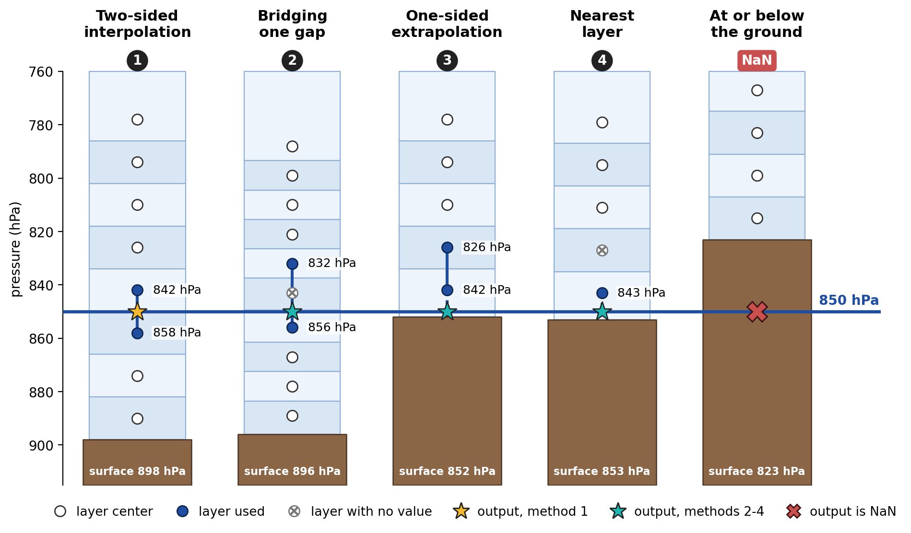
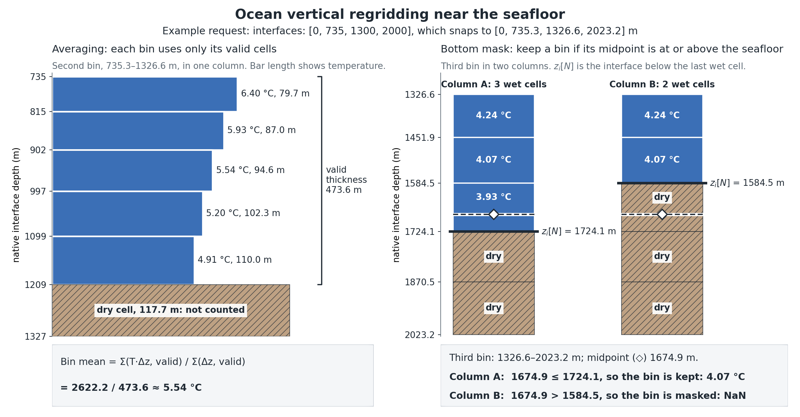

.. _replay:

Replay
######

NOAA's `UFS Replay <https://psl.noaa.gov/data/ufs_replay/>`_ dataset is available
as zarr in the ``noaa-ufs-gefsv13replay`` bucket on Google Cloud Storage.
The atmosphere and ocean are stored separately, and ufs2arco has a source for each:

* ``gcs_replay_atmosphere``: the FV3 atmosphere, on 127 native levels, for example
  ``gs://noaa-ufs-gefsv13replay/ufs-hr1/0.25-degree-subsampled/03h-freq/zarr/fv3.zarr``

* ``gcs_replay_ocean``: the MOM6 ocean, on 75 native levels, for example
  ``gs://noaa-ufs-gefsv13replay/ufs-hr1/1.00-degree/06h-freq/zarr/mom6.zarr``

Both are Cloud Zarr sources. See :ref:`cloud-zarr-time-handling` for how timestamps
and gaps are handled, and :doc:`moving_data` for accumulating variables over time.
To reuse a spatial mask fitted from a training dataset, see :doc:`static_masks`.

Available Variables
-------------------

For the full list of variables and their metadata, see the
`UFS Replay website <https://psl.noaa.gov/data/ufs_replay/>`_ and
`this notebook <https://nbviewer.org/gist/timothyas/f37ec28562e97c74217401fceb144f1f>`_.

.. _replay-pressure-levels:

Atmosphere: pressure levels
---------------------------

Replay uses the hybrid vertical coordinate of FV3: layers are terrain-following
near the surface and converge to pressure levels toward the upper atmosphere.
A layer's pressure therefore varies with location and time, so selecting a
nominal Replay layer near 850 hPa does not produce the same field as diagnosing
the 850-hPa surface. The ``layers_to_pressure`` transform diagnoses isobaric
fields from the full UFS-Replay atmospheric column, using column-dependent
pressure and interpolation in log-pressure.

Inputs
^^^^^^

The ``layers_to_pressure`` transform computes the pressure of each layer from four support fields.
Include them in ``source.variables``, with their declared units, alongside the
variables to interpolate:

* ``pressfc``: floating-point surface pressure in Pa.
* ``tmp``: native-layer temperature in K.
* ``spfh``: native-layer specific humidity in kg/kg.
* ``delz``: native-layer thickness in meters, using the UFS negative convention.

It also needs the complete, ordered 127-level Replay grid, so do not set
``source.levels`` or slice ``source.slices.sel.level`` for this source.

The variables to interpolate must contain the native level dimension, have
floating-point data, and declare their units. Output names must be unique and
different from existing input names.

Example recipe
^^^^^^^^^^^^^^

This recipe produces only pressure-level zonal winds at 200, 250, and 850 hPa:

.. code-block:: yaml
   :caption: pressure-winds.yaml

   mover:
     name: datamover
     batch_size: 1
   directories:
     zarr: pressure-winds.zarr
     cache: cache
     logs: logs
   multisource:
     - source:
         name: gcs_replay_atmosphere
         uri: /path/to/replay/fv3.zarr
         local: true
         time:
           start: 2020-01-01T00
           end: 2020-01-02T18
           freq: 6h
         variables: [pressfc, tmp, spfh, delz, ugrd]
       transforms:
         layers_to_pressure:
           variables:
             ugrd: ugrd_pl
           levels_hpa: [200, 250, 850]
           below_ground: mask
   target:
     name: anemoi
     use_level_index: false
     sort_channels_by_levels: true
     variables_with_nans: [ugrd_pl_200, ugrd_pl_250, ugrd_pl_850]
     chunks:
       time: 1
       variable: -1
       ensemble: 1
       cell: -1

Adjust the ``source`` section for your data before running:

* ``uri`` and ``local``: this example reads a local copy of the data. To read from
  the cloud, set ``uri`` to the cloud location and ``local`` to ``false``.
* ``time``: set ``start``, ``end``, and ``freq`` to the period of interest, using
  dates available in the store.

Then run it as ``ufs2arco pressure-winds.yaml``.

Anemoi packs the output as ``ugrd_pl_200``, ``ugrd_pl_250``, and ``ugrd_pl_850``.
Each channel's metadata records its pressure units, level, and interpolation
details. ``levels_hpa`` accepts distinct positive integers up to 1100.

To add these channels to an existing recipe, append this source after the
existing entries in ``multisource``:

* All sources must use the same sample coordinates and end on the same horizontal
  grid.
* Keep finite-volume vertical regridding and ocean diagnostics in other source
  entries. Neither can share a transform sequence with ``layers_to_pressure``.
* Support fields do not become extra output channels, because the transform returns
  only the requested derived variables.

Check the orientation of the input winds. If they need rotating, include both
``ugrd`` and ``vgrd`` and add ``rotate_vectors`` to the pressure source. Rotation
runs before pressure interpolation, and horizontal regridding runs after it.

Interpolation
^^^^^^^^^^^^^

For each column and target pressure, the transform uses the first of these
methods that applies:

1. **Two-sided interpolation:** use an exact pressure match, or interpolate
   between the adjacent native layers on either side of the target. This is the
   normal case.
2. **Bridging one gap:** if one native layer next to the target has no value,
   interpolate between the layers on either side of the gap, provided they span
   at most 25 hPa.
3. **One-sided extrapolation:** extrapolate from an adjacent pair of layers above
   the target (at lower pressure), provided the nearer layer is within 10 hPa of
   the target and that distance does not exceed the spacing of the pair.
4. **Nearest layer:** use the value of a layer above the target, provided it is
   the only available one within 10 hPa.

Methods 2-4 apply only when two-sided interpolation is not possible. Methods 3
and 4 never use layers below the target (at higher pressure).

   Diagnosing 850 hPa. Columns 1-4 show the methods above. In the last column
   the target is below ground, so the output is NaN.

Missing values
^^^^^^^^^^^^^^

The output remains NaN where:

* the target is at or below the ground (surface pressure less than or equal to
  the target)
* surface pressure is missing
* the layer pressures around the target are out of order
* none of the methods above applies

List the pressure channels in ``variables_with_nans`` so that expected terrain
masks do not mark an entire date as missing. This does not fill NaNs or configure
the training loss, so training still needs its own mask or fill policy. See
:doc:`static_masks` for a fixed domain derived from the training data.

If ``compute_temporal_residual_statistics`` is enabled, a time difference is only
counted at grid cells with valid values at both times. Cells that are below
ground at either time are left out of that difference, so the statistics remain
valid as the below-ground area changes with surface pressure.

Limitations
^^^^^^^^^^^

The transform requires native Replay inputs and is not a general conversion for
other hybrid grids. Before a large conversion, compare the output with reference
pressure-level fields and check memory use, because each source read loads a
complete sample.

.. _replay-ocean:

Ocean transforms
----------------

These transforms calculate density, mixed-layer depth (MLD), and ocean heat
content (OHC) from native water-column profiles, and can then average the profiles
onto a coarser vertical grid. They are written for the Replay MOM6 grid, but can
be configured for other native grids as described below. In a multisource recipe,
configure them inside the ocean source entry so they are not applied to
atmospheric fields.

Inputs and ordering
^^^^^^^^^^^^^^^^^^^

The transforms use these inputs by default:

* ``temp``: potential temperature in degrees Celsius.
* ``so``: practical salinity in psu, with the same dimensions and sizes as ``temp``.
* ``level``: finite, strictly increasing, nonnegative layer-center depths in
  meters, positive down. Units may be omitted, but if present they must be meters.

Use the complete native ocean column. For Replay, do not select a subset with
``source.levels`` or ``source.slices.sel.level`` before these transforms.
Density and OHC also support complete single-layer grids. MLD needs at least two
levels and must also pass the native-grid checks described below.

Diagnostics always run before ``fv_vertical_regrid_ocean`` and horizontal
regridding, regardless of YAML key order. If vertical regridding is enabled, it
averages density but leaves MLD and OHC unchanged, because they have no ``level``
dimension.

Configuration
^^^^^^^^^^^^^

This example calculates native-level density, MLD at two thresholds, and OHC to
300 m, then coarsens the vertical profiles. Omit any diagnostics you do not need.
In particular, skip density if you only need the two-dimensional diagnostics.

.. code-block:: yaml

   transforms:
     ocean_density:
       temperature: temp
       salinity: so
       name: rho
       ref_pressure: 0.0
       subtract_1000: false
       eos: wright
     mixed_layer_depth:
       temperature: temp
       salinity: so
       thresholds: [0.03, 0.125]
       names: [mld003, mld0125]
     ocean_heat_content:
       temperature: temp
       depths: [300]
       names: [ohc300]
       output_units: GJ m-2
       require_full_depth: true
     fv_vertical_regrid_ocean:
       interfaces: [0, 1, 21, 75, 120, 200, 350, 500]
       use_nearest_interfaces: true
       keep_weight_var: false

Diagnostic output names must be unique and must not replace existing variables.
They also must not end with an underscore followed by digits, because Anemoi reads
that suffix as a vertical level. For example, use ``mld003`` and ``ohc300``, not ``mld_003`` and
``ohc_300``.

Density
^^^^^^^

``ocean_density`` uses the Wright equation of state. Set ``eos`` to ``wright_full``
(or its alias ``wright``), or to ``wright_red`` for the reduced form. Output is in
``kg m-3``.

* ``ref_pressure: 0.0`` gives surface-referenced potential density. Any other
  finite, nonnegative value is a reference pressure in Pa.
* ``ref_pressure: null`` gives approximate in-situ density using
  ``p = rho0 * g * level``, with ``rho0 = 1035 kg m-3`` and ``g = 9.8 m s-2``.
* ``subtract_1000: true`` subtracts 1000 from density to give sigma.

Density is calculated from each level's temperature and salinity. Averaging this
density generally gives a different result from calculating density from averaged
temperature and salinity.

When calling ``ufs2arco.ocean_diagnostics.wright_density`` directly from Python,
pass ``check_range=True`` to log warnings for inputs outside the equation-of-state
fit range. This is off by default, and it evaluates lazy inputs.

Mixed-layer depth
^^^^^^^^^^^^^^^^^

``mixed_layer_depth`` calculates potential density at zero reference pressure and
compares each level with the top model layer. Moving down the column, it finds the
first level where density is rising and the difference crosses the threshold. It
then interpolates linearly between the two adjacent layer centers to find the depth
where the difference equals the threshold. Only ``ref_pressure: 0.0`` is supported.
The default equation of state is ``wright_full``.

The default threshold is ``0.03 kg m-3``, with output name ``mld``. Multiple
thresholds need one explicit output name each. To compare with the archived
``MLD_0125`` field, use ``thresholds: [0.125]`` and ``names: [mld0125]``. Output is
in meters.

By default, the transform rejects a grid unless it meets these checks, which guard
against diagnosing MLD from too coarse a profile:

* exactly 75 levels (``expected_level_count``)
* a deepest layer center at least 5000 m deep (``minimum_deepest_level``)
* at least 10 layer centers shallower than 200 m (``min_levels_in_search`` and
  ``mld_search_depth``)
* layer-center spacing of at most 25 m above that depth (``max_level_spacing``)

For another native grid, change these options to suit. ``expected_level_count`` and
``minimum_deepest_level`` can also be set to ``null`` to turn those checks off.

Each column is handled as follows:

* The first nonfinite temperature or salinity ends the valid column.
* An invalid surface gives NaN.
* If there is no crossing and the deepest valid density difference is still below
  the threshold, MLD is the depth of the deepest valid layer center.
* Any other column gives NaN. Set ``pathological_to_nan: false`` to keep a value of
  zero instead.

Ocean heat content
^^^^^^^^^^^^^^^^^^

For a requested depth ``D``, ``ocean_heat_content`` evaluates:

.. math::

   Q_D = \rho_0 C_p \sum_k T_k\,\Delta z_{k,D}.

Here ``T`` is potential temperature in degrees Celsius and ``dz`` is the thickness
of each layer between the surface and ``D``. The last layer contributes only its
portion above ``D``, so the integration is exact at the requested depth.

Both constants are configurable. The defaults are ``rho0: 1035`` (kg m-3) and
``heat_capacity: 3991.86795711963`` (J kg-1 K-1). The heat-capacity default follows
MOM6's conservative-temperature convention, while Replay supplies potential
temperature.

The result is heat content relative to 0 degrees Celsius. Water below 0 degrees
makes a negative contribution, so a deeper integral is not always larger. The
result is not heat potential above a 26-degree threshold or the total internal
energy of the grid cell.

``output_units`` defaults to ``GJ m-2``, using an exact ``1e-9`` conversion from
joules. ``J m-2`` is also supported, but typical values overflow fp16 storage. For
reference, a uniform 10-degree column to 300 m gives approximately
``12.39475 GJ m-2``.

``depths`` defaults to ``[700, 2000, null]``, named ``ohc700``, ``ohc2000``, and
``ohc``. ``null`` integrates to the local bottom. For finite depths:

* ``require_full_depth: true`` gives NaN wherever the contiguous finite temperature
  column does not reach the requested depth.
* ``require_full_depth: false`` integrates to the shallower of the requested depth
  and the local bottom, so the integration depth can vary between grid cells.

An invalid surface gives NaN, and finite temperatures below the first invalid level
are ignored.

Vertical regridding
^^^^^^^^^^^^^^^^^^^

``fv_vertical_regrid_ocean`` requires ``temp`` to find the wet column. The
``interfaces`` option sets the requested output boundaries. The native interfaces
that describe the source cells come from the first available of:

1. ``source_interfaces``
2. an input ``interface`` or ``z_i`` coordinate
3. the packaged interfaces, for a matching complete Replay grid
4. interfaces reconstructed from the layer midpoints, for other grids

Explicit native interfaces must describe every source cell, start at zero, strictly
increase, and bracket the layer centers.

By default, ``use_nearest_interfaces: true`` snaps the requested boundaries to
native interfaces. For Replay, ``[0, 1, 21, 75]`` resolves to approximately
``[0, 1.0308075, 21.0937099, 73.3164215] m``. The output ``interface`` coordinate
records the resolved boundaries, and its metadata keeps the requested ones.
Out-of-range requests and boundaries that snap to the same interface are rejected.
With ``use_nearest_interfaces: false``, requests must match native interfaces
exactly.

Each output bin is the thickness-weighted average of the complete source cells whose
centers lie inside it. Source cells are not split to match the original, unsnapped
boundaries. Each variable's average uses only its own finite values within the wet
column, so equal-thickness values ``[20, NaN]`` average to ``20``. Infinities are
also excluded, and bins with no valid values remain NaN.

The wet column is the unbroken run of finite ``temp`` values starting at the top
layer, so a temperature gap excludes every deeper cell. For ``N`` wet cells, the
local bottom is native interface ``z_i[N]``. An output bin is kept only if its
midpoint is at or above this interface. A kept bin may straddle the bottom, with
only wet cells contributing to its average, so this is not an exact
fractional-bottom-cell calculation.

   Left: a bin averages only its valid cells. Right: the same bin is kept when its
   midpoint is at or above the local bottom interface and masked when it is deeper.
   Cell depths are from the Replay grid. Temperatures are illustrative.

``weight_var`` defaults to ``dz`` and names the calculated native thicknesses.
With ``keep_weight_var: true``, the retained weight is the nominal full thickness
of the output bin, not each variable's finite or local wet thickness.

Anemoi output and masks
^^^^^^^^^^^^^^^^^^^^^^^

List channels that can contain land or shallow-water NaNs in the target:

.. code-block:: yaml

   target:
     variables_with_nans: [rho, mld003, mld0125, ohc300]

An optional ``multisource_masks`` rule can align diagnostics with an ocean
reference such as ``uo_0``. Its ``mask_variables`` list must use the exact packed
channel names. When choosing a mask:

* A land mask does not remove the valid NaNs over shallow shelves in fixed-depth
  OHC.
* A land mask is not an open-water mask, and MLD remains meaningful beneath sea ice.

Adding channels changes variable ordering and statistics, so use fresh output and
cache paths, and the same diagnostic definitions across all dataset splits.

Geometry and operational limits
^^^^^^^^^^^^^^^^^^^^^^^^^^^^^^^

These diagnostics use nominal, fixed depth coordinates, not time-varying MOM6 ALE
thicknesses or sea-surface height. Adding ``ho`` to the source variables does not
change this.

Where interfaces are absent, they are reconstructed from the midpoints as
``z_i[0] = 0`` and ``z_i[k+1] = 2 * level[k] - z_i[k]``. Any other definition of
layer centers needs explicit interfaces: use ``ocean_heat_content.interfaces`` for
integration and ``fv_vertical_regrid_ocean.source_interfaces`` for regridding.

Diagnose MLD before any temporal averaging or anomaly calculation, because its
nonlinear threshold rule does not commute with averaging or horizontal regridding.
MLD from archived profiles may differ from an online MOM6 diagnostic using ALE
geometry.

MLD and OHC accept lazy Dask inputs but need a single complete ``level`` chunk. If
needed, rechunk with ``.chunk({'level': -1})`` before calling them. Full Replay
samples can use several GiB per worker, so check memory and throughput with a small
representative run before processing a full dataset.
